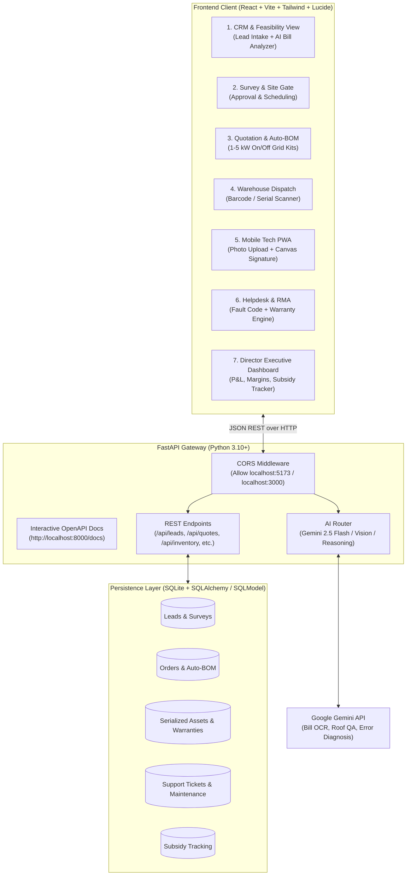
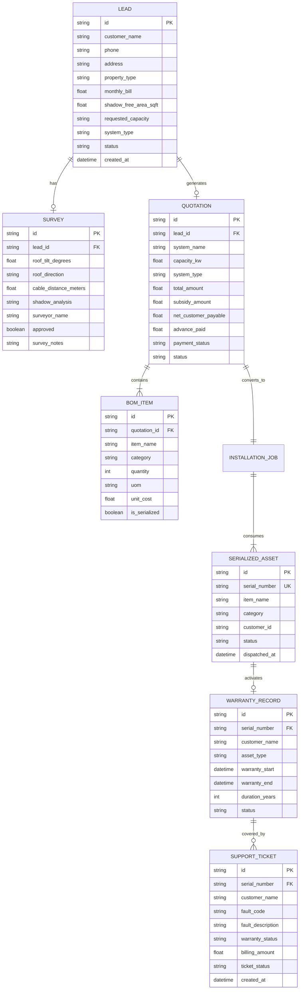

# 🏗️ ARCHITECTURE.md — System Design & Data Contracts
**System:** SunPower Solutions — Solar Installation Management System  
**Team Architecture:** 2-Member Team Split (User: Backend | Partner: Frontend)  

---

## 1. High-Level Architecture Diagram



---

## 2. Recommended Tech Stack

| Layer | Technology | Why Chosen for Hackathon |
| :--- | :--- | :--- |
| **Backend (Dev 1 - You)** | **Python + FastAPI + Pydantic v2** | - Auto-generates interactive Swagger UI at `http://localhost:8000/docs`.<br>- Instant strict validation through Pydantic models.<br>- Native, effortless Gemini API integration with Python SDK.<br>- Built-in CORS support. |
| **Database** | **SQLite + SQLAlchemy / SQLModel** | - Zero database setup/installation headaches.<br>- Instant file-based storage (`sunpower.db`), highly portable for demoing. |
| **Frontend (Dev 2 - Partner)** | **React (Vite) + Tailwind CSS + Lucide Icons** | - Blazing fast hot-module reload.<br>- Pre-styled utility classes (Tailwind) for responsive desktop & mobile screens.<br>- Simple canvas library (`react-signature-canvas`) for customer sign-off. |
| **AI Engine** | **Google Gemini 2.5 Flash** | - Multimodal: processes bill images, roof photos, and fault code diagnostics.<br>- Extremely fast inference speeds (<1s) for live judging demo. |

---

## 3. Relational Schema & Entity-Relationship Model



---

## 4. End-to-End API Route Blueprint

All endpoints are prefixed with `/api/v1`.

### 1. Leads & Feasibility
- `POST /api/v1/leads` — Create new inquiry
- `GET /api/v1/leads` — List all inquiries with filtering (`pending_survey`, `survey_approved`, `quoted`)
- `POST /api/v1/leads/{id}/survey` — Submit site survey results (roof tilt, azimuth, cable run, approval)

### 2. Auto-BOM & Quotations
- `GET /api/v1/templates/bom` — Fetch pre-configured standard BOM templates (1kW–5kW On-Grid / Off-Grid)
- `POST /api/v1/quotes/generate` — Generate official quote + auto-populated BOM for an approved lead
- `POST /api/v1/quotes/{id}/payment` — Record advance or full customer payment (triggers warehouse dispatch queue)

### 3. Inventory & Barcode Dispatch
- `GET /api/v1/dispatch/queue` — Fetch orders ready for packing and dispatch
- `POST /api/v1/dispatch/scan` — Verify & assign serial numbers (inverters, batteries, charge controllers)
- `POST /api/v1/dispatch/{order_id}/complete` — Complete dispatch $\to$ automatically initiates warranty clock

### 4. Field Technician Handover
- `GET /api/v1/field/jobs/{tech_id}` — List scheduled jobs for the field crew
- `POST /api/v1/field/jobs/{id}/complete` — Upload installation photos, actual kW verified, and customer signature data

### 5. Helpdesk & 20-Year Warranty Engine
- `GET /api/v1/warranty/lookup?serial_number=...` — Instant warranty validity check ($<2$ yrs inverter/battery, $<20$ yrs panels)
- `POST /api/v1/tickets` — Log breakdown complaint with fault code. If warranty is active $\to$ ₹0 replacement ticket; If expired $\to$ auto-generates parts & labor invoice.
- `PATCH /api/v1/tickets/{id}/resolve` — Mark complaint closed on customer verification

### 6. Director Executive Analytics
- `GET /api/v1/analytics/dashboard` — Aggregates:
  - Total monthly revenue & gross margin percentage
  - Profit breakdown per installation job
  - Government subsidy tracking funnel (Submitted $\to$ Inspected $\to$ Disbursed)
  - Open service breakdown tickets & SLA status

### 7. AI Capabilities (Gemini 2.5 Flash)
- `POST /api/v1/ai/analyze-bill` — Multi-modal OCR of electricity bill $\to$ returns optimal kW capacity & subsidy eligibility
- `POST /api/v1/ai/inspect-roof-photo` — Vision check of completed installation for quality & earthing verification
- `POST /api/v1/ai/diagnose-fault` — Translates inverter fault codes (e.g., `E-04`, `PV Isolation Low`) into actionable repair guides

---

## 5. Zero-Mismatch Contract Strategy for 2-Person Team

To guarantee **zero errors** between Frontend and Backend:

1. **Standardized Response Envelope:** Every API endpoint returns identical JSON envelopes:
   ```json
   {
     "success": true,
     "data": { ... },
     "message": "Operation completed successfully"
   }
   ```
2. **Auto-Generated Swagger Documentation:**
   - The Backend serves Swagger UI at `http://localhost:8000/docs`.
   - The Frontend partner can test every endpoint live directly in the browser without writing code.
3. **Shared TypeScript Types (`frontend_types.ts`):**
   - The backend defines Pydantic models. We provide the identical TypeScript interfaces in `frontend_types.ts` so the frontend dev has full auto-complete and zero field typos.
4. **Mock Fallback Flag (`USE_MOCK=true`):**
   - The frontend partner can work immediately on UI components with local mock JSON even before the backend server is running.
5. **CORS Configuration:**
   - FastAPI backend explicitly enables `allow_origins=["*"]`, `allow_credentials=True`, `allow_methods=["*"]`, `allow_headers=["*"]`.
