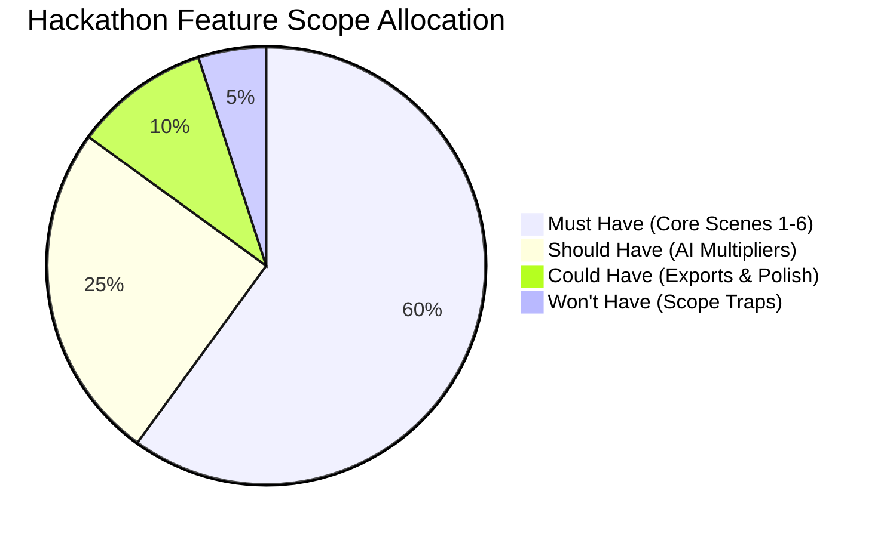

# 🎯 FEATURES.md — Prioritized Feature Specification
**Project:** SunPower Solutions — Solar Installation Management System  
**Framework:** MoSCoW Prioritization (Must Have / Should Have / Could Have / Won't Have)  

---

## 1. Feature Prioritization Matrix

---

## 2. MUST HAVE (P0 — Mandatory for Winning Demo)

These features cover 100% of the operational scenes described in the hackathon brief. Both team members must prioritize these in the first 12 hours.

### Module 1: Rooftop Inquiry & Feasibility Gate (Scene 1)
- **F1.1 Omnichannel Lead Capture:**
  - Form capturing: Customer Name, Phone, Address, Monthly Electricity Bill (₹), Shadow-Free Roof Area (sq.ft), Requested Capacity (1kW to 5kW), System Type (On-Grid / Off-Grid).
  - Status progression: `New` $\to$ `Feasibility Checked` $\to$ `Survey Scheduled` $\to$ `Survey Approved`.
- **F1.2 Technical Site Survey Approval:**
  - Surveyor inputs: Measured Roof Tilt (e.g., $22^\circ$), Azimuth/Direction (e.g., South-Facing), Cable Run Length (meters), Earthing Resistance ($<5\,\Omega$).
  - One-click "Approve Feasibility" action. **Quotation generation is blocked until survey is approved.**

### Module 2: The Kit & Auto-BOM Quotation Engine (Scene 2)
- **F2.1 Pre-Engineered BOM Templates:**
  - Standardized kits for **1 kW, 2 kW, 3 kW, 4 kW, 5 kW** in both **On-Grid** and **Off-Grid**.
  - Selecting "3 kW On-Grid" instantly resolves exact parts:
    - Solar Panels: 6x 540W Mono-PERC Half-cut
    - Inverter: 1x 3.3 kW Single-Phase Grid-Tied Inverter
    - Structure: 1x Elevated Galvanized Iron Mounting Stand
    - Electrical: ACDB/DCDB boxes, 4 sq.mm solar DC cable (30m), copper earthing rod
- **F2.2 Staged Payment Tracking:**
  - Tracks Total Order Value, Central/State Subsidy deduction, Net Customer Payable.
  - Records Staged Payments: **Advance Payment (minimum 20%)** or **Full Payment**.
  - Recording advance payment automatically pushes the job to the Warehouse Dispatch queue.

### Module 3: Warehouse Dispatch & Serial Number Barcode Engine (Scene 3)
- **F3.1 Serialized Asset Verification:**
  - Mandatory serial number scanning/input for high-value components before shipment (Inverter, Batteries, Charge Controller).
  - Prevents dispatch if high-value parts lack assigned unique serials.
- **F3.2 Automated Warranty Clock Activation:**
  - On completing dispatch, system generates linked warranty records:
    - Inverter & Battery: **2-Year Replacement Warranty**
    - Solar Panels: **20-Year Performance Warranty**
  - Timestamps start date = Dispatch date; Expiry date is auto-calculated.

### Module 4: On-Roof Field Technician Handover (Scene 4)
- **F4.1 Mobile-Friendly Installation Checklist:**
  - Tech logs start and completion timestamp.
  - Confirms system size and checks safety isolation breaker.
- **F4.2 Digital Customer Acceptance:**
  - Tech uploads photo of completed rooftop array.
  - Homeowner signs directly on screen (HTML5 canvas signature).
  - Marks job status `Installed & Handed Over`.

### Module 5: Rainy Season Breakdown & Warranty Helpdesk (Scene 5)
- **F5.1 Instant Customer & Serial Lookup:**
  - Search by Customer Name, Phone, or Serial Number (e.g., `INV-3KW-9021`).
  - Displays instant visual badge: `ACTIVE WARRANTY (Expires Oct 2028)` or `EXPIRED WARRANTY`.
- **F5.2 Intelligent Ticket & Billing Generation:**
  - Log fault code (e.g., `ERR-F24: Inverter Grid Disconnect`).
  - If Under Warranty: Generates ₹0 free replacement work order.
  - If Expired: Automatically generates repair invoice with replacement hardware cost + technician service fee.

### Module 6: Director Month-End Executive Dashboard (Scene 6)
- **F6.1 Real-Time Profitability Engine:**
  - Calculates profit per installation:
    $$\text{Gross Profit} = \text{Customer Invoiced} - \text{Hardware Cost (BOM)} - \text{Technician Labor Cost}$$
- **F6.2 Executive KPI Cards:**
  - Total Monthly Revenue & Net Margin percentage.
  - Active installations vs. Completed this month.
  - Government Subsidy Tracking Pipeline (Pending $\to$ Inspected $\to$ Disbursed).
  - Open service breakdown tickets with turnaround time.

---

## 3. SHOULD HAVE (P1 — AI Multipliers to Win Judges' Choice)

These features take advantage of Google Gemini API (free & fast) and give SunPower Solutions a major technological edge over other hackathon teams.

### F7.1 📸 AI Smart Electricity Bill Analyzer (Gemini 2.5 Flash Vision)
- Customer or sales rep uploads photo/PDF of their DISCOM monthly electricity bill.
- Gemini extracts: Monthly Units (kWh), Sanctioned Load (kW), Average Bill Amount (₹).
- System auto-computes:
  - Recommended Solar Capacity: $\text{Units} \div 120 = \text{Recommended kW}$
  - Estimated PM Surya Ghar Subsidy (e.g., ₹78,000 for 3kW)
  - Estimated 25-Year Electricity Bill Savings

### F7.2 🔍 AI Finished Roof Photo Quality Inspector (Gemini Vision)
- Technician uploads photo of installed rooftop solar panels.
- Gemini performs visual quality check:
  - Panel alignment and tilt check.
  - Absence of visible shade obstruction.
  - Safety cabling and earthing indicator.
  - Returns instant score: `Installation Approved: 95/100`.

### F7.3 ⚡ AI Inverter Fault Code Assistant (Gemini Flash)
- Support rep types fault code (e.g., `Fault 104 - Ground Fault Low Resistance`).
- Gemini explains root cause in plain English + provides step-by-step diagnostic checklist for the technician.

---

## 4. COULD HAVE (P2 — Polish if Ahead of Schedule)

- PDF Quotation Export: 1-click generation of branded PDF quotation for homeowner.
- SMS / WhatsApp Simulation: Modal showing automated WhatsApp notification sent to customer ("Your 3kW Solar Kit is out for delivery with Serial #INV-3021").
- Dark / Light Mode toggle.

---

## 5. WON'T HAVE (Out of Scope — Avoid These Traps!)

- ❌ Real payment gateway integration (Razorpay/Stripe live keys): Use mock payment confirmation modal with simulated payment IDs.
- ❌ GPS Live Truck Tracking: Simulated status updates are sufficient.
- ❌ Multi-branch complex accounting books: Focus on Job Gross Margin, not complex ledger debit/credit balances.
