# ⏱️ ROADMAP.md — 24-Hour Build Schedule for 2-Member Team
**Hackathon:** Odoo x GECT Hackathon (Oct 31 – Nov 1)  
**Roles:** Dev 1 (You) — Backend, Database & AI | Dev 2 (Partner) — Frontend, UI/UX & Demo Flow  

---

## 1. Team Synchronization Strategy: Zero-Wait Parallel Development

```mermaid
gantt
    title 24-Hour Hackathon Sprint Plan
    dateFormat X
    axisFormat Hour %H
    section Architecture & Setup
    API Contract & Data Scaffolding      :active, 0, 2
    section Dev 1 (Backend Track)
    FastAPI Core + SQLite Models         :crit, 2, 6
    Auto-BOM & Serial Engine             :2, 8
    Warranty Engine & Helpdesk Logic     :8, 12
    Gemini AI Integrations (OCR/Vision)  :12, 16
    section Dev 2 (Frontend Track)
    UI Shell + Navigation + Mock Store   :crit, 2, 6
    CRM & Auto-BOM Quotation UI          :6, 10
    Field Tech PWA & Signature Canvas    :10, 14
    Director Dashboard & Charts          :14, 18
    section Integration & Pitch
    End-to-End API Integration & Testing :crit, 18, 21
    Demo Scripting, Slides & Polish      :21, 24
```

---

## 2. Hour-by-Hour Execution Plan

### 🚀 Phase 1: Foundation & Contract Lockdown (Hours 0 – 2)
**Goal:** Agree on schemas and establish mock data so Frontend can build immediately without waiting for Backend.
- **Both:** Review `API_CONTRACT.md` and lock in the request/response payloads.
- **Dev 1 (Backend):**
  - Initialize Python virtual environment (`python -m venv venv`).
  - Install dependencies: `fastapi`, `uvicorn`, `pydantic`, `sqlalchemy`, `google-genai`, `python-multipart`.
  - Configure CORS middleware (`allow_origins=["*"]`).
  - Verify FastAPI Swagger UI loads at `http://localhost:8000/docs`.
- **Dev 2 (Frontend):**
  - Scaffold React app (`npm create vite@latest frontend -- --template react`).
  - Install dependencies: `tailwindcss`, `lucide-react`, `axios`, `react-signature-canvas`.
  - Copy `frontend_types.ts` into `src/types/` and create mock data store (`mockData.js`).
  - Set up navigation tabs: CRM $\to$ Quotation $\to$ Dispatch $\to$ Field App $\to$ Helpdesk $\to$ Director Dashboard.

---

### 🏗️ Phase 2: Core MVP Pipeline (Hours 2 – 8)
**Goal:** Complete the forward operational lifecycle: Lead $\to$ Survey $\to$ BOM $\to$ Dispatch.
- **Dev 1 (Backend):**
  - Build Lead creation and Site Survey approval endpoints (`/api/v1/leads`).
  - Implement BOM generator logic for 1–5 kW On-Grid and Off-Grid packages (`/api/v1/quotes/generate`).
  - Implement Dispatch module with mandatory serial verification for Inverters and Batteries (`/api/v1/dispatch/scan`).
  - Trigger automatic 2-year and 20-year warranty record generation on dispatch completion.
- **Dev 2 (Frontend):**
  - Build **Lead Intake & Feasibility Form**: captures electricity bill, shadow-free area, and capacity.
  - Build **Survey Approval Gate Modal**: inputs roof tilt, direction, and cable length; shows "Survey Approved" badge.
  - Build **Quotation & Auto-BOM View**: dropdown to pick 1kW–5kW On/Off-Grid; instantly displays itemized parts table and subsidy breakdown.
  - Build **Warehouse Dispatch Screen**: barcode/serial number input fields with instant validation tags.

---

### 📱 Phase 3: Field Operations & Warranty Engine (Hours 8 – 14)
**Goal:** Complete field handover and after-sales support (Scenes 4 & 5).
- **Dev 1 (Backend):**
  - Build Field Job completion endpoint (`/api/v1/field/jobs/complete`) accepting photo URLs/base64 and signature vector.
  - Build Warranty Lookup Engine (`/api/v1/warranty/lookup`): calculates elapsed time since dispatch and returns Active vs. Expired status.
  - Build Helpdesk Ticket generator:
    - If Under Warranty: ₹0 replacement work order.
    - If Expired: Itemized repair invoice (Parts + ₹1,500 labor).
  - Seed database with realistic demo cases:
    - Customer A: Installed 4 months ago $\to$ Active Warranty.
    - Customer B: Installed 28 months ago $\to$ Expired Inverter Warranty (monsoon fault code demo!).
- **Dev 2 (Frontend):**
  - Build **Field Tech Mobile View**: clean tablet/phone responsive UI with job checklist, photo upload preview, and digital signature pad (`react-signature-canvas`).
  - Build **Support & Helpdesk Desk**:
    - Serial search bar with instant status badge (Green for Active, Orange for Expired).
    - Fault code dropdown (`ERR-F24: Inverter Failure`, `ERR-B02: Battery Low Charge`).
    - Dynamic billing indicator (₹0 under warranty vs. Auto-invoiced).

---

### 🧠 Phase 4: Executive Dashboard & AI Magic (Hours 14 – 18)
**Goal:** Build the Director P&L view and integrate Gemini AI capabilities.
- **Dev 1 (Backend):**
  - Build Executive Analytics endpoint (`/api/v1/analytics/dashboard`): Gross Margin calculation ($\text{Revenue} - \text{BOM} - \text{Labor}$), subsidy funnel counts, open tickets count.
  - Integrate Gemini 2.5 Flash endpoints:
    - `/api/v1/ai/analyze-bill`: Parses bill data $\to$ returns recommended kW & subsidy.
    - `/api/v1/ai/inspect-roof-photo`: Evaluates finished installation photo quality.
    - `/api/v1/ai/diagnose-fault`: Returns plain English troubleshooting steps for error codes.
- **Dev 2 (Frontend):**
  - Build **Director Executive Dashboard**:
    - Revenue, Margin, Jobs Completed, Subsidy Pending KPI cards.
    - Table of recent jobs with individual profit margins.
    - Subsidy tracker pipeline bar (`Paperwork Submitted` $\to$ `DISCOM Inspected` $\to$ `Subsidy Disbursed`).
  - Add **AI Assistant Triggers**:
    - "Scan Bill with AI" button on CRM form.
    - "AI Roof Quality Check" button on Field Tech screen.
    - "AI Fault Diagnosis" button on Helpdesk screen.

---

### 🔌 Phase 5: Live API Integration & Error Elimination (Hours 18 – 21)
**Goal:** Switch frontend from mock mode to live backend and fix all network/payload discrepancies.
- **Both:**
  - Update frontend `.env`: `VITE_API_URL=http://localhost:8000/api/v1`.
  - Walk through all 6 scenes sequentially in the UI:
    1. Submit inquiry $\to$ Check Swagger backend DB.
    2. Approve survey $\to$ Generate BOM quote.
    3. Record advance payment $\to$ Dispatch and scan serials.
    4. Sign off on Field App $\to$ Check active warranty record.
    5. Search serial in Helpdesk $\to$ Verify ₹0 vs. billed ticket.
    6. View Director Dashboard $\to$ Verify updated margin and charts.
  - Fix any null handling, date formatting, or validation error responses.

---

### 🎤 Phase 6: Demo Rehearsal & Pitch Preparation (Hours 21 – 24)
**Goal:** Ensure the 5-minute presentation is bulletproof and unforgettable.
- Prepare demo dataset with pre-filled test customers:
  - *Lead in progress*: Sharma Villa (3 kW On-Grid)
  - *Dispatch in warehouse*: Kapoor Textiles (5 kW Off-Grid)
  - *Monsoon breakdown claim*: Verma Residence (Serial `INV-3KW-9021`)
- Record a backup 3-minute screen recording walkthrough in case wifi or projector fails during judging.
- Create 5-slide pitch deck: Problem $\to$ Solution $\to$ Live Demo $\to$ Architecture $\to$ Business Impact.
